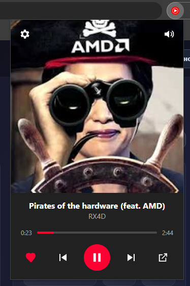
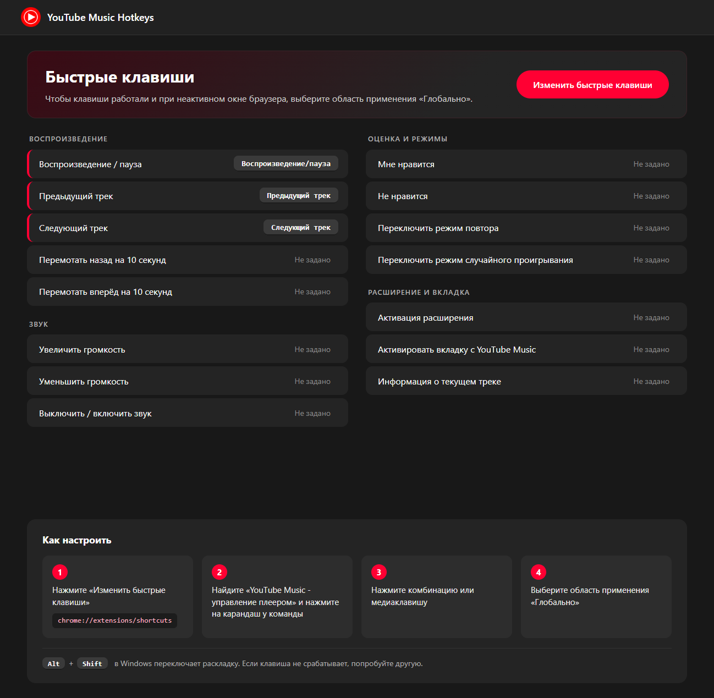

# YouTube Music Hotkeys

Расширение для Google Chrome, которое управляет YouTube Music с клавиатуры и из всплывающего плеера: можно переключать треки, менять громкость и ставить лайки, не переходя на вкладку с музыкой.

## Что есть в расширении

- **Всплывающий плеер**: клик по иконке показывает обложку, название и исполнителя, прогресс трека, кнопки `Play / Pause`, `Предыдущий`, `Следующий`, лайк и переход на вкладку с музыкой.
- **Перемотка**: по полоске прогресса можно кликнуть или потянуть её, и трек перемотается.
- **Громкость**: кнопка с динамиком в углу обложки. При наведении появляется ползунок, колесо мыши меняет громкость, клик по кнопке включает и выключает звук.
- **Быстрые клавиши**: 15 команд, которые настраиваются в `chrome://extensions/shortcuts`. По умолчанию заданы медиаклавиши `MediaPlayPause`, `MediaPrevTrack` и `MediaNextTrack`. Если выбрать область применения «Глобально», они работают и при неактивном окне браузера.
- **Страница настроек**: список всех команд с текущими клавишами и подсказка, как их изменить.
- **Если YouTube Music не открыта**: попап показывает уведомление с кнопкой открытия сервиса.
- **Экран ошибки**: если не удалось прочитать плеер, попап показывает текст ошибки и кнопку «Повторить».
- **Автозапуск по закладке**: добавьте к адресу `&autoplay=true`, и трек начнёт играть после открытия страницы.

## Технологии и API

- `Manifest V3`
- `chrome.commands`: быстрые клавиши
- `chrome.scripting`: управление плеером на странице `music.youtube.com`
- `chrome.notifications`: уведомление с информацией о треке

## Установка расширения в браузер

### Google Chrome

1. Скачайте или клонируйте репозиторий в папку на компьютере.
2. Откройте страницу расширений: `chrome://extensions`
3. Включите режим разработчика (`Developer mode`).
4. Нажмите **Load unpacked / Загрузить распакованное расширение**.
5. Выберите папку `add-on` (в ней лежит `manifest.json`).
6. Откройте [music.youtube.com](https://music.youtube.com/), запустите трек и нажмите на иконку расширения.

## Пример

### Всплывающий плеер

### Страница настроек

## Лицензия

Иконка нарисована для этого проекта в стиле логотипа YouTube Music.

Расширение распространяется под [CC0](LICENSE): автор отказался от авторских прав в пределах, допустимых законом.
